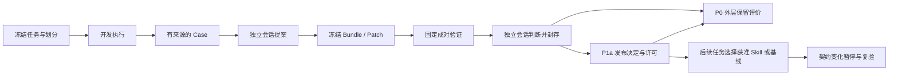

# 架构与扩展边界

TraceVolve 的优化核心编排实验，CodexAdapter 保留 Codex 自身的模型和工具循环。资源环境、受控代码任务与评价器由宿主控制，候选只能修改明确开放的组件。

## 模块

| 模块 | 职责 |
|---|---|
| `contracts.py` | Bundle、Patch、完整执行快照、适配器与验证规划协议 |
| `codex.py` | 认证隔离、启动上下文检查、Codex 子进程、取消、事件归一化、加载核验 |
| `tasks.py` | DAG 生成、结构分组、双射变换、动作状态机、确定性评价 |
| `code_tasks.py` / `code_corpus.py` | 代码问题模板、受控文件操作、独立验收与冻结参考证书 |
| `code_runner.py` / `code_protocol.py` | macOS 代码沙箱、宿主结果比较、独立代码证据契约 |
| `task_server.py` | 每次执行独占的 MCP stdio 入口、加载门槛、工具回执 |
| `store.py` | SQLite 控制状态、请求预留、追加审计链、不可变 JSON 对象 |
| `study.py` | 冻结、自然候选、A/B/C、判断封存、外层评价、导出 |
| `memory.py` | 许可适用性、发布父版本检查、回滚、契约变化与复验 |
| `recorded_judge.py` | 按精确原版请求哈希回放，未知请求失败 |
| `_vendor/` | 不改动的 v0.2.1 校验与回放实现 |

## 事实、知识与控制

原始 Codex 事件、MCP 请求和响应不被 Case 覆盖。Case 引用开发运行；Patch 引用 Case 和来源运行；Evidence 引用两侧精确执行快照。知识变更产生新内容哈希。SQLite 保存会话状态、研究阶段、许可和发布指针，不能依赖重建检索索引恢复这些控制状态。

执行快照包含 Bundle、CLI 版本与二进制哈希、模型参数、适配器及工具源码、工具契约、执行限制、实际 Skill 内容版本和固定注入策略。许可是独立控制对象，不加入 Bundle 的可变哈希，避免批准后改变被批准对象。

远端模型权重版本不能从 CLI 版本或本地配置哈希推导。当前模型身份记录请求配置；不可获得的服务版本明确为 unknown。无法完整记录的底层 HTTP 请求次数与费用也不被推算为已知。

## 隔离边界

模型执行工具只有本次资源 MCP 入口。该进程可以读取本次任务与 Bundle、修改自己的内存状态和宿主审计文件，但不暴露任意路径、SQL 或 shell 参数。模型无法通过工具覆盖 checker。错误动作不改变任务状态；所有动作消耗资源工具调用额度。

提案器只获得开发 Case。判断器只获得旧版 `judge_request` 白名单投影，并且无资源 MCP。没有将保留集、SQLite、源码或其他任务挂载为可调用工具。宿主进程本身仍运行在操作者账户下，因此这不是针对恶意本机所有者的安全隔离系统。

个人 Skill 的自动发现与原生技能目录会随客户端环境变化，单独更改工作目录或 `CODEX_HOME` 不足以证明排除。适配器逐次离线渲染启动上下文，显式禁用外部条目，再检查实际启动配置。只有系统内置上下文和本次明确注入的组件参与执行。

## 发布与复验

正式发布需要通过固定检查和维护者确认。发布在事务内比较父版本和 generation，并更新默认指针与许可。另一个候选不能基于过期父版本覆盖它。回滚恢复基线指针并暂停相关许可。

注入前检查许可状态、任务族、Bundle 与声明的工具依赖，返回 applicable、inapplicable 或 unknown；unknown 不自动启用。运行中依赖与模式检查由资源工具状态机执行。

契约变化会暂停相关许可。候选可在显式隔离实验中参与复验，复验不会自动授权正式执行。当前仅实现单 Skill 的直接声明依赖；组合技能传播、未知语义依赖推断及抽查属于 P2/P3。

## 扩展接口

`AgentAdapter`、`EnvironmentAdapter`、`ValidationPlanner` 是未来运行时、任务和验证插件的边界。当前任务插件包含资源 DAG 和受控 Python 代码维护；二者各自保留任务语义与证据协议。CodexAdapter 只声明 prompt/skill 可编辑，不接受 Workflow 或脚本补丁。

按用户批准新增了第二任务域；P1b 的第二运行时、P2 的诊断选择和动态多轮升级、P3 的可执行组件与拓扑编辑均未实现。当前单轮和声明依赖示例不能证明通用性、H1/H2/H3 或任何论文贡献。

## 代码维护任务的补充边界

代码任务复用 CodexAdapter、请求账本、成对执行、判断封存和许可生命周期，
通过 task profile 分派自己的工具、初始 Prompt、任务划分与评价器。
资源 v0.2.1 校验器保持原样；代码配对采用 `code-maintenance-v1` 契约，
不把代码文件包装为资源 DAG，也不宣称已完成第二运行时适配。

任务文件由 MCP 托管，模型只能读写允许的 Python 文件。每次公开／补充测试
在独立临时目录内执行，macOS Seatbelt 拒绝宿主用户文件、网络与 fork。
模型不能改动宿主期待值；最终源文件作为 task artifact 保存，Prompt／Skill
另作为 Harness 候选冻结。源代码执行的功能测试与固定文本 Skill 的发布检查
是两条不同的证据链。生产上没有任意 Harness 脚本修改接口。

注册表的基线及发布 scope 来自冻结研究；代码 Skill 不能通过资源任务族的
默认指针被启用。代码工具 v2 对 `write_file` 增加 `expected_sha256`，
原经验先暂停，再在隔离会话中复验。后续任务在初次任务划分中一并冻结，
不会与开发、验证或保留集共享问题模板。
